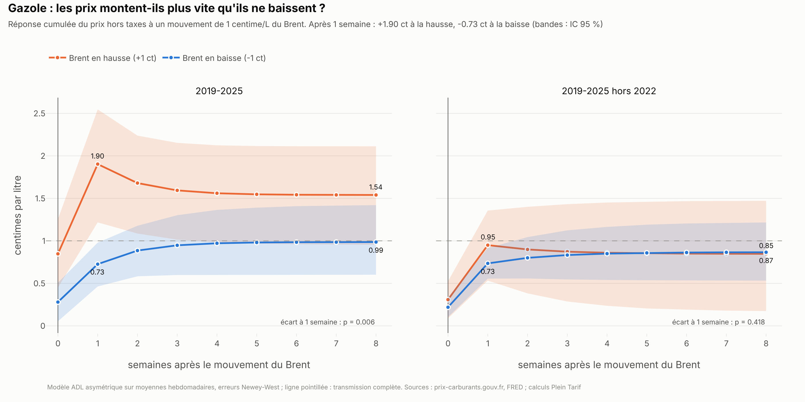
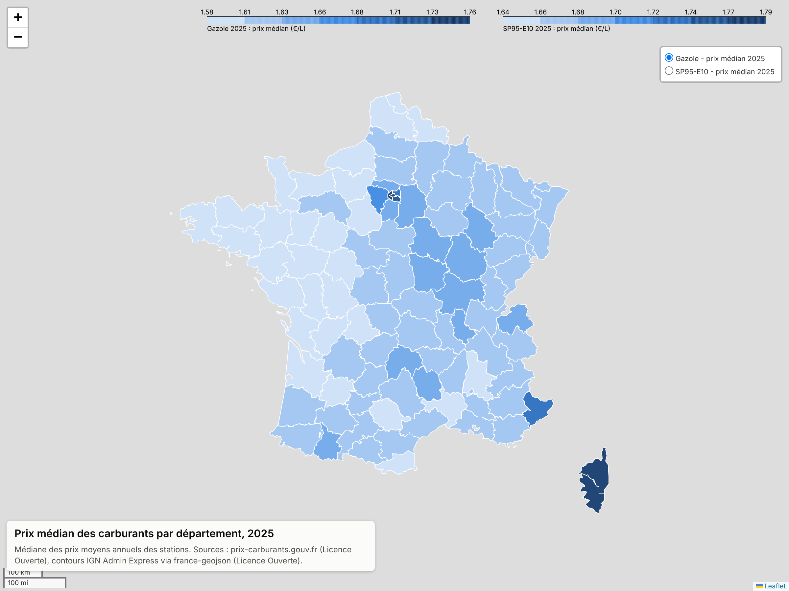
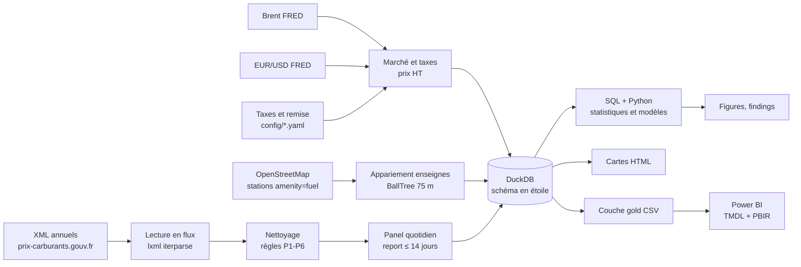

# Plein Tarif

**Le prix des carburants en France est-il juste ?** Sept ans de prix à la pompe (2019-2025, 71 millions de prix
quotidiens, 11 382 stations), croisés avec le Brent, les taxes et les enseignes, pour savoir où, chez qui et quand
les automobilistes paient le plus, et si les prix baissent aussi vite qu'ils montent.

## La question

Je me place dans le rôle d'un analyste pour une association de consommateurs ou une autorité de la concurrence :

1. **Géographie** : écarts de prix entre départements, régions et grandes villes.
2. **Autoroute** : quelle prime par rapport aux stations à moins de 10 km ?
3. **Enseignes** : grande distribution, pétroliers et indépendants.
4. **« Rockets & feathers »** : les prix hors taxes suivent-ils le Brent aussi vite à la baisse qu'à la hausse ?
5. **Crise de 2022** : la remise de l'État est-elle arrivée à la pompe ?
6. **Comparer** : combien rapporte d'aller à la station la moins chère du quartier ?
7. **Jour de la semaine** : y a-t-il un bon jour pour faire le plein ?
8. **Recommandations** pour les automobilistes et pour un régulateur.

## Résultats clés

- **20,5 cts/L** séparent la médiane du gazole dans le Finistère (1,580 €) de celle de Paris (1,785 €) en 2025, mais
  80 % des départements tiennent dans une fourchette de **5,9 cts** : les écarts se concentrent en Corse et en petite
  couronne parisienne.
- **L'autoroute coûte 18,5 cts/L de plus** (gazole, 2025) que les stations à moins de 10 km le même jour ; 93,5 %
  des stations d'autoroute sont plus chères que leurs voisines, et la prime est passée de 15,9 cts en 2019 à 18,5 cts.
- **La grande distribution est 9,5 cts moins chère que les pétroliers** (médianes 1,598 € et 1,693 €). À géographie
  égale, Système U et E.Leclerc sont 3,5 cts sous leurs voisines ; TotalEnergies 5,4 cts au-dessus, Agip/Eni 9,2.
- **« Rockets & feathers » : oui pour le gazole, mais à cause de 2022.** Une hausse de 1 ct du Brent fait monter le
  prix HT de 1,85 ct en une semaine, une baisse ne le fait baisser que de 0,70 ct (écart significatif, p = 0,008).
  Hors 2022 l'asymétrie disparaît (p = 0,43) : elle reflète la flambée des marges de raffinage du gazole.
- **La remise de 2022 est arrivée à la pompe** : −22,0 cts sur le gazole autour du 1er avril pour 18 cts de remise ;
  à sa suppression, +12,8 cts pour 10 cts, avec une reprise de marge HT d'environ 2 cts.
- **Comparer rapporte plus de 20 fois plus que choisir son jour** : à Toulouse, aller à la station la moins chère à
  moins de 5 km fait économiser **72 € par an** (15 000 km, 6 L/100), contre 3 € pour le meilleur jour de la semaine.

Détails, chiffres et réserves : [reports/findings.md](reports/findings.md).





Cartes interactives : [départements 2025](reports/maps/carte_departements_2025.html),
[départements 2022](reports/maps/carte_departements_2022.html), [Toulouse](reports/maps/carte_toulouse.html)
(à télécharger puis ouvrir dans un navigateur).

### Tableau de bord Power BI

Cinq pages : Vue d'ensemble, Carte des prix, Qui est moins cher ?, Rockets & Feathers, Simulateur d'économies.

<!-- Captures à ajouter après ouverture dans Power BI Desktop :


-->

## Recommandations

**Automobilistes** : éviter de faire le plein sur l'autoroute (≈ 10 € d'économie sur un plein de 55 L), privilégier
la grande distribution, comparer dans un rayon de 5 km ; le jour de la semaine n'a presque pas d'effet.

**Régulateur** : examiner la prime autoroute (en hausse, quasi générale) ; surveiller la Corse et la petite couronne
parisienne (9 à 17 cts au-dessus de la médiane) ; suivre publiquement les marges de raffinage et de distribution en
période de crise, pas seulement le Brent ; ajouter l'enseigne et des coordonnées fiables au flux de données ouvertes.

## Données et méthode

Détail complet : [docs/methodology.md](docs/methodology.md) et [docs/data_dictionary.md](docs/data_dictionary.md).

- **Formats qui changent selon l'année** : les fichiers XML annuels stockent les prix en millièmes d'euro jusqu'en
  2021 (`1328`) puis en euros (`1.328`). L'unité est détectée par fichier, jamais supposée. Les coordonnées sont en
  degrés × 100 000. Lecture en flux (`lxml.iterparse`) pour une mémoire stable.
- **Nettoyage chiffré** : bornes, doublons, écart robuste à la médiane du jour (par type de route), pics isolés ;
  0,18 % des 32 millions d'enregistrements retirés, avec le compte de chaque règle.
- **Du changement de prix au prix quotidien** : les stations ne déclarent que les changements ; le dernier prix est
  reporté au plus 14 jours (7 jours perdaient jusqu'à 45 % des stations actives en période calme : choix mesuré et
  documenté).
- **Prix hors taxes** : `TTC / (1 + TVA) − accise + remise`, avec les taux officiels par année, carburant et zone
  (majorations régionales, Île-de-France, Corse) ; validé contre la série officielle du ministère à moins de
  0,1 ct près.
- **Enseignes** : appariement de chaque station à la station OpenStreetMap la plus proche (BallTree haversine,
  75 m), normalisation des enseignes ; 62 % des stations actives rattachées.
- **Statistiques** : IC bootstrap, comparaisons appariées, modèle à retards échelonnés asymétrique avec erreurs de
  Newey-West et tests de Wald, étude d'événement, tests du khi-deux et effets fixes.
- **Contrôles** : SQL et pandas donnent les mêmes chiffres ; corrélation de 1,00 avec la moyenne officielle mensuelle
  (écart de niveau expliqué par la pondération par volumes) ; 48 tests unitaires.

## Architecture



## Outils

Python 3.11+ (lxml, pandas, NumPy, PyArrow, SciPy, statsmodels, scikit-learn, Plotly, folium), **DuckDB** (SQL :
CTE, fonctions de fenêtre, `QUALIFY`, `FILTER`, `GROUPING SETS`, `ROLLUP`, `ASOF JOIN`), pytest, Power BI
(projet `.pbip` : modèle TMDL, rapport PBIR, DAX).

## Lancer le projet

```bash
pip install -r requirements.txt
```

```bash
python run.py all
```

`make all` fait la même chose. La commande télécharge les données (environ 200 Mo de prix), les traite, construit
la base, lance les analyses, produit les cartes et la couche gold, puis exécute les tests (environ 20 minutes). Les
étapes sont aussi disponibles une par une : `download`, `parse`, `clean`, `enrich`, `model`, `analyze`, `maps`,
`export`, `test`.

Les enseignes viennent d'OpenStreetMap par l'API Overpass. Si elle n'est pas joignable, utiliser l'extrait France
de download.openstreetmap.fr (environ 6 Go, supprimé automatiquement après extraction) :

```bash
PLEIN_TARIF_OSM_SOURCE=pbf python run.py all
```

**Power BI** : ouvrir `powerbi/PleinTarif.pbip`, régler le paramètre `DataFolder` sur le dossier `data\gold\`, puis
actualiser. Pas à pas et valeurs attendues : [powerbi/BUILD_GUIDE.md](powerbi/BUILD_GUIDE.md).

## Limites

- Le Brent est du pétrole brut : les prix de gros du gazole et de l'essence ne sont pas disponibles librement, et les
  marges de raffinage ont beaucoup bougé en 2022.
- Les enseignes ne sont connues que pour les stations rattachées à OpenStreetMap (62 % des stations actives).
- Les stations ne déclarent que les changements de prix : le prix quotidien est reconstruit (report d'au plus
  14 jours).
- L'outre-mer (prix administrés, 2 stations dans les fichiers) est exclu.
- Les résultats décrivent des corrélations, pas des liens de causalité.

## Sources et licences

- Prix des carburants : [prix-carburants.gouv.fr](https://www.prix-carburants.gouv.fr/rubrique/opendata/),
  Licence Ouverte / Open Licence (Etalab).
- Brent (`DCOILBRENTEU`, source EIA) et EUR/USD (`DEXUSEU`, Federal Reserve) : FRED, Federal Reserve Bank of
  St. Louis. BCE en secours pour l'EUR/USD.
- Taxes et prix moyens officiels : Ministère de la Transition écologique (Guide 2026 sur la fiscalité des énergies,
  prix moyens HTT/TTC, marge brute de raffinage), Licence Ouverte.
- Enseignes : © contributeurs OpenStreetMap, données sous licence
  [ODbL](https://opendatacommons.org/licenses/odbl/). La table d'appariement est un fichier séparé
  (`data/processed/station_brands.parquet`).
- Contours des départements : [france-geojson](https://github.com/gregoiredavid/france-geojson) (IGN Admin Express),
  Licence Ouverte. Fond de carte de Toulouse : © contributeurs OpenStreetMap.

## Contact

Oussama Essalehi — [linkedin.com/in/oussama-essalehi](https://www.linkedin.com/in/oussama-essalehi) —
[oussama-essalehi.dev](https://oussama-essalehi.dev)
